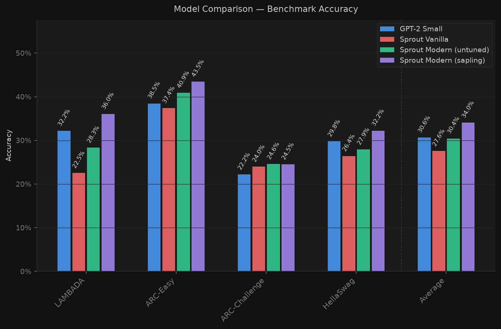
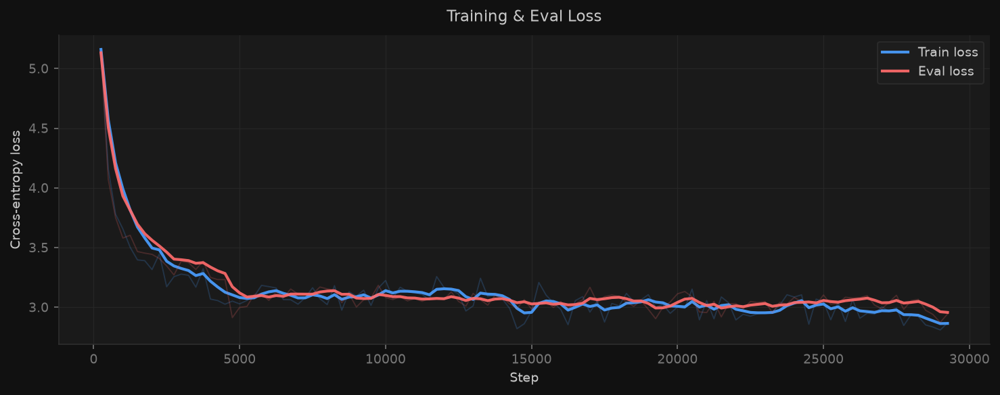
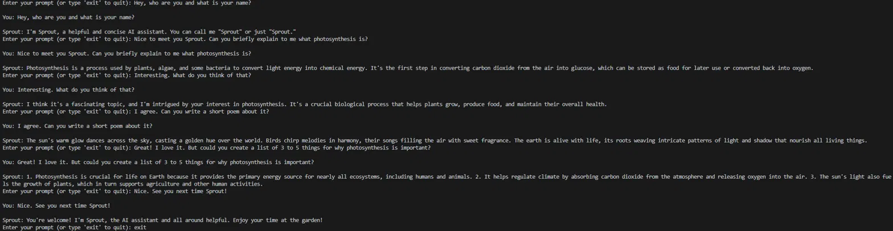

# Sprout

Sprout is a small language model written from scratch in PyTorch. The project covers the tokenizer, the data pipeline, three model architectures, the training loop, benchmark evaluation and supervised fine-tuning (SFT). All models were trained locally on one NVIDIA RTX 4070 (12 GB). The largest model, Sapling, has 134M parameters and scores a 34.0% benchmark average. GPT-2 Small (124M) scores 30.6% on the same benchmarks.



## Background

The project tests two questions. Can a language model be trained completely on local hardware and still give sensible results? Can architecture and optimizer techniques from recent years beat a model that was trained with more compute a few years earlier? GPT-2 Small serves as that reference model.

## Usage

Requirements: Python 3.12, PyTorch 2.11 with CUDA, and an NVIDIA GPU with bfloat16 support. Install the package in a virtual environment:

```bash
git clone https://github.com/philipp-sz/Sprout.git
cd Sprout
python -m venv .venv
source .venv/bin/activate
pip install -r requirements.txt
pip install -e .
```

The pipeline runs as a sequence of scripts. Paths, checkpoints and hyperparameters are set at the top of each script and in the `config.py` files.

```bash
python -m sprout.tokenizer.download_tokenizer_data   # sample text for the tokenizer
python -m sprout.tokenizer.train_tokenizer           # train the byte-level BPE tokenizer
python -m sprout.data.run_data_processing            # tokenize the pretraining mix into shards
python -m sprout.base.run_training                   # train Vanilla
python -m sprout.modern.run_training                 # train Modern / Sapling
python -m sprout.modern.run_eval                     # LAMBADA, ARC-Easy, ARC-Challenge, HellaSwag
python -m sprout.modern.inference                    # sample text from a checkpoint
```

SFT adds two chat tokens to the tokenizer and the embedding table, then fine-tunes:

```bash
python -m sprout.tokenizer.extend_tokenizer
python -m sprout.sft.resize_model_embeddings
python -m sprout.sft.run_sft_data_processing
python -m sprout.sft.run_sft_training
python -m sprout.sft.inference                       # chat with the fine-tuned model
```

`pytest` runs the tests for the tokenizers and the data loader.

## Results

Three models were trained on the same data with the same tokenizer and a context length of 1024.

- Vanilla is a GPT-2-style baseline.
- Modern keeps Vanilla's size and replaces the architecture, optimizer and learning-rate schedule with current components.
- Sapling uses the Modern components with a wider shape, 4 KV heads, an MLP expansion of 4.75 and 15B training tokens.

Benchmark accuracy is measured with the evaluator in `sprout/eval.py` on the full test sets. GPT-2 Small was evaluated with the same code.

| Model | Parameters | Training tokens | LAMBADA | ARC-Easy | ARC-Challenge | HellaSwag | Average |
|---|---|---|---|---|---|---|---|
| GPT-2 Small | 124M | not disclosed | 32.2% | 38.5% | 22.2% | 29.8% | 30.6% |
| Vanilla | 111M | 2.5B | 22.5% | 37.4% | 24.0% | 26.4% | 27.6% |
| Modern | 100M | 2.5B | 28.3% | 40.9% | 24.6% | 27.9% | 30.4% |
| Sapling | 134M | 15B | 36.0% | 43.5% | 24.5% | 32.2% | 34.0% |

Vanilla and Modern each trained for about 13 hours. Sapling trained for about 88 hours at 48,000 tokens per second. Its loss curves:



After SFT on 200M tokens of `smol-smoltalk`, Sapling holds a short multi-turn conversation:



The choice of Sapling's shape is based on a short architecture ablation, described in [`docs/ablation.md`](docs/ablation.md).

## How it works

### Tokenizer

A byte-level BPE tokenizer is trained from scratch. It has 256 byte tokens, 32,511 merges and one end-of-text token, for a vocabulary of 32,768. The fast trainer (`fast_bpe_tokenizer.py`) stores the corpus as linked lists and keeps pair counts in a max-heap with lazy deletion. After each merge it only updates the pairs next to the merged position.

### Data

The pretraining mix is streamed from Hugging Face, tokenized with 8 worker processes and written to fixed-size `.npy` shards. Metadata records the processed rows, so an interrupted run resumes where it stopped.

| Source | Share |
|---|---|
| FineWeb-Edu | 45% |
| DCLM Baseline 1.0 | 45% |
| FineMath (`finemath-4plus`) | 6% |
| StarCoder subset of OLMo Mix 1124 | 4% |

### Models

| | Vanilla | Modern | Sapling |
|---|---|---|---|
| Layers | 12 | 12 | 8 |
| `d_model` | 768 | 768 | 1024 |
| Query heads / KV heads | 12 / 12 | 12 / 3 | 16 / 4 |
| Attention | multi-head | grouped-query | grouped-query |
| Position encoding | learned | RoPE (base 5,000) | RoPE (base 5,000) |
| Normalization | LayerNorm | RMSNorm, QK-Norm | RMSNorm, QK-Norm |
| MLP | 4×, GELU | 4×, ReLU² | 4.75×, ReLU² |
| Optimizer | AdamW | Muon + AdamW | Muon + AdamW |
| Peak learning rate | 6e-4 | 1e-3 | 1e-3 |
| Schedule | cosine, 2% warmup | WSD, 2% warmup, 10% decay | WSD, 2% warmup, 10% decay |
| Tokens per step | 512,000 | 516,096 | 512,000 |
| Training tokens | 2.5B | 2.5B | 15B |

All models tie the input embedding to the output layer and use weight decay 0.1, betas (0.9, 0.95) and gradient clipping at 1.0. Muon updates the 2D weight matrices. AdamW updates the embeddings, norms and other parameters. The Modern models include a KV cache for generation. When a generation exceeds the 1024-token context, the cache is refilled with the most recent 512 tokens. The batch sizes in the `config.py` files default to 64 × 16 sequences. The training scripts override them to fit into 12 GB (10 × 50 or 12 × 42).

### Training

The training loop in `sprout/train.py` uses bfloat16 autocast, `torch.compile`, FlashAttention through `scaled_dot_product_attention`, gradient accumulation and resumable checkpoints. Every 250 steps it logs loss, gradient norm, throughput and a 1,000-sample benchmark estimate.

### Evaluation

Multiple-choice benchmarks (ARC-Easy, ARC-Challenge, HellaSwag) score each answer by its length-normalized log-likelihood given the context. LAMBADA checks whether the model predicts the final word. Every scored sequence starts with the end-of-text token, which separates documents during pretraining. GPT-2 Small is scored the same way with its own `<|endoftext|>` token. Version 1.0 scored without this prefix, and Sapling's average was 33.5% with that protocol (tag `v1.0`).

### SFT

Conversations are formatted in ChatML with `<|im_start|>` and `<|im_end|>`. The loss is computed only on assistant tokens. Whole conversations are packed into 1024-token sequences, and the remainder is padded. Conversations longer than 1024 tokens are skipped.

## Project structure

```
sprout/
  tokenizer/   BPE tokenizer: reference and fast implementation, training scripts
  data/        streaming, tokenization and sharding
  base/        Vanilla model, config, training, evaluation, inference
  modern/      Modern model (also used for Sapling), config, training, evaluation, inference
  sft/         ChatML data processing, embedding resize, SFT training, chat inference
  baselines/   evaluation of Hugging Face models (GPT-2 Small)
  utils/       sampling, plotting, model helpers
  train.py     training loop
  eval.py      benchmark evaluator
docs/          architecture ablation
tests/         tokenizer and data loader tests
```

## Limitations

- Model weights, tokenizer files and data shards are not published. Reproducing the results requires running the full pipeline.
- Batch sizes differ slightly between the runs (512,000 and 516,096 tokens per step).
- SFT packs several conversations into one sequence without intra-document masking. Tokens can attend to earlier conversations in the same sequence.
- The models are trained on English text only.
- The QK-Norm gains of the trained models were stored in bfloat16. Their updates were too small to change them, so they stayed at 1.0. Version 1.1 stores them in float32 for new training runs.
- The tokenizer tests load a tokenizer state file that is not in the repository, so `pytest` fails on a fresh clone.

Implemented by the author. The v1.1 bug fixes were made with Claude Code after a code review.

## License

MIT, see [`LICENSE`](LICENSE).
