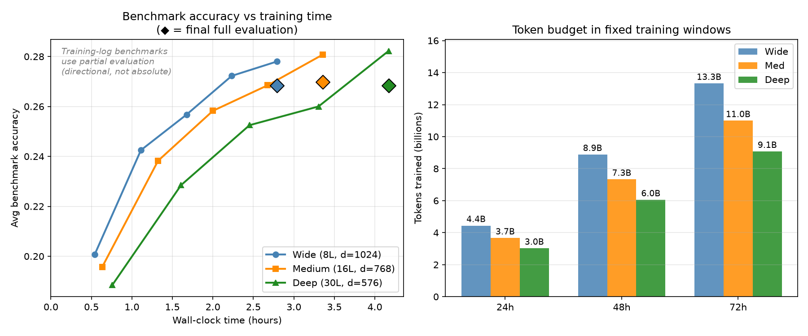

# Architecture ablation

Before the 15B-token run, three shapes of the Modern architecture were trained on the same 525M tokens for 1,000 steps each. The ablation picks the shape for Sapling.

| Shape | Layers | `d_model` | Query / KV heads | Parameters | Tokens per step | Throughput | Time for 1,000 steps | Final average |
|---|---|---|---|---|---|---|---|---|
| Wide | 8 | 1024 | 16 / 4 | 122M | 12 × 42 × 1024 | 51,400 tok/s | 2.8 h | 26.8% |
| Medium | 16 | 768 | 12 / 4 | 126M | 10 × 50 × 1024 | 42,400 tok/s | 3.4 h | 27.0% |
| Deep | 30 | 576 | 9 / 3 | 125M | 8 × 64 × 1024 | 35,000 tok/s | 4.2 h | 26.8% |

All three use an MLP expansion of 4 and the Modern optimizer and schedule. The deep shape matches SmolLM2-135M. "Final average" is the mean accuracy on LAMBADA, ARC-Easy, ARC-Challenge and HellaSwag after the last step, on the full test sets.

After 1,000 steps the three shapes score within 0.2 percentage points of each other. The wide shape reaches that point in 2.8 h, the deep shape in 4.2 h. In a fixed training window the wide shape processes about 47% more tokens than the deep shape (13.3B against 9.1B in 72 h).

Sapling uses the wide shape. Its MLP expansion was raised from 4 to 4.75, which brings it to 134M parameters, close to SmolLM2-135M.

## Limitations

- The batch sizes differ between the three runs. At step 1,000 the deep run had completed its learning-rate decay, while the wide and medium runs had not.
- The curves in the left plot use the 1,000-sample benchmark estimates from the training log. They were measured without the end-of-text prefix (v1.0 protocol). Only the final points are full evaluations with the v1.1 protocol.
- Each shape was trained once, for 525M tokens. Deeper shapes may pull ahead in longer runs.
